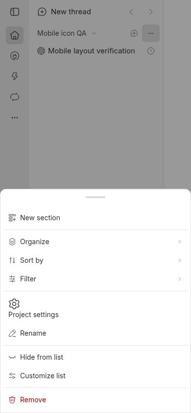
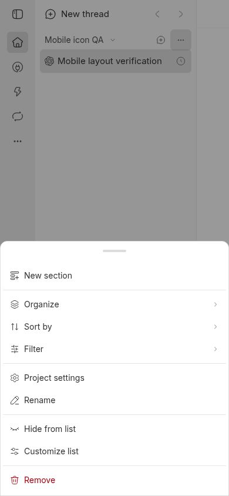
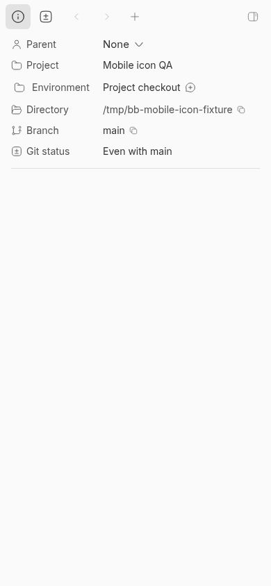
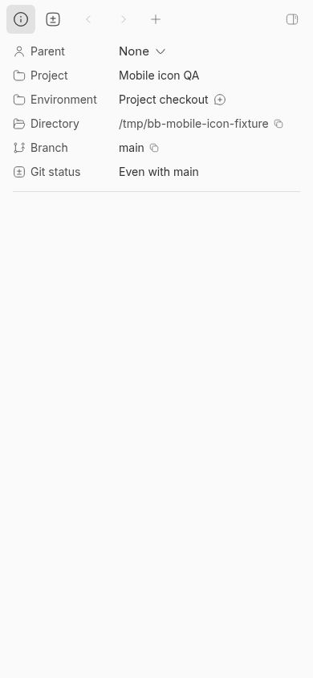

# Mobile project icon layout investigation

Issue: https://github.com/get-bb/bb/issues/6366

BB-Thread-ID: thr_9nj88w94j6

Base: b6743a36bd9eae1408c35cfc2c7ab1d2419dc79d

The screenshots use a synthetic project and scheduled thread in a fresh source development database on Debian 13. No agent turn was dispatched. Chromium used a 390 × 844 touch viewport.

## Project settings

The actual sidebar project action rendered `button[role=menuitem] > a > svg` on the base revision. Its row measured 60px high and its gear 24 × 24px. Rename measured 36px high with a 16 × 16px icon.

After making the compact DropdownMenuItem honor `asChild`, Project settings is an anchor with `role=menuitem`. The row measures 36px high and its gear 16 × 16px. Clicking it opens the project settings route.

## Thread Info

The reporter supplied an iOS screenshot showing Environment shifted relative to Project. The default checkout icon aligned in the independent Chromium and Linux WebKit runs, so those runs do not independently confirm the reporter's exact setup.

To exercise the sizing failure, a temporary provider-icon registration returned a fixed 24px flex frame containing a 16px Folder icon. This uses the existing provider icon slot and models artwork with intrinsic dimensions. The fixture was removed after verification and is not part of the product change.

With the original intrinsic minimum sizing, the Environment frame expands to 24px: the glyph starts at x=20 and its label at x=46, while Project starts at x=16 and x=38. With explicit zero minimum dimensions on the Thread Info icon slot, the frame remains 16px and both rows start at x=16 and x=38. The screenshots below show this controlled fixture, not the reporter's original installation.

## Checks

- Owner-boundary menu test: compact case fails on the base (`expected 'BUTTON' to be 'A'`), desktop case passes; both pass after the repair.
- 59 focused app tests pass, including responsive overlays, provider icons, and ThreadMetadataContent.
- Turbo lint and typecheck for app/shared-ui pass; app lint reports existing warnings in unrelated files.
- The sidebar plugin was rebuilt through Turbo and reloaded in the isolated app before final browser checks. Reloading the core Vite module alone does not update the already built plugin copy.
- Linux Playwright WebKit passes at 320, 390, and 430px touch widths and 1280px desktop width: aligned default metadata rows, correctly sized settings icon, an exposed/non-inert app root, and real navigation to project settings. DOM measurements are in webkit-mobile.json and webkit-desktop.json.
- iOS Simulator Safari and the reporter's physical iPhone were unavailable. Linux Playwright WebKit is not iOS Safari verification.

> AGENT GENERATED
