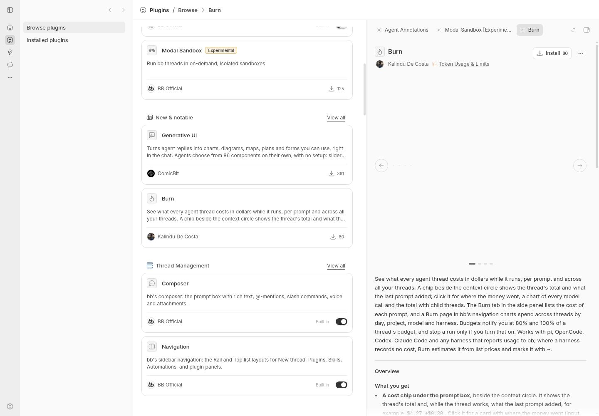
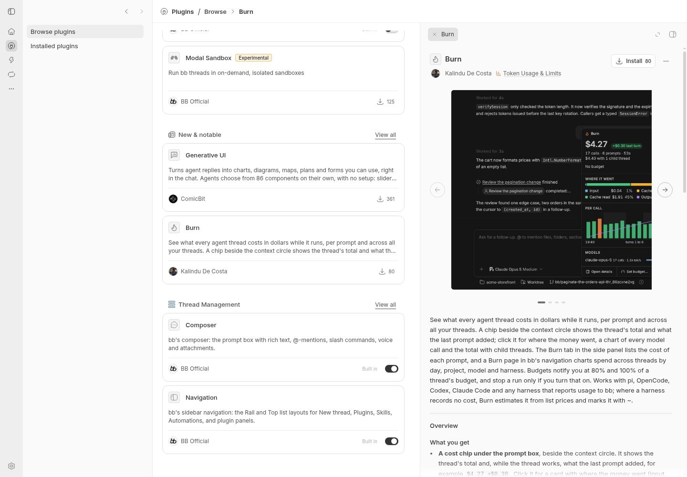

# Plugins catalog bulk-close investigation

Investigating BB thread: `thr_xgwfbkrvmp`.

## Environment

- Latest upstream `main` at investigation time: `f8c0701e94ba74a09bf48b1dcc4f49aa22ce81b7`.
- Built from source in a dedicated worktree with a fresh, isolated development data directory (`pnpm dev`).
- Debian GNU/Linux 13, x86_64; Node v22.23.2; pnpm 9.15.0; headless Chrome 156, 1440 × 1000 viewport.
- No agent/provider session or plugin installation is needed to reproduce this.

## Reproduction on unmodified main

1. Open **Plugins → Browse plugins**.
2. Open **Agent Annotations**, **Modal Sandbox [Experimental]**, then **Burn** from their catalog cards. Keep all three tabs open, with Burn active.
3. Right-click the **Burn** detail tab in the right panel, then click **Close other tabs**.
4. Observe that **Agent Annotations** remains beside Burn. Only Modal Sandbox closes.

Expected: only Burn remains.

### Before the action



### Actual result on main

The screenshot still shows **Agent Annotations** and **Burn** in the tab strip.


Browser snapshot and the exact persisted `bb.plugins.workspace.tabs` value:

```text
- button "Agent Annotations installed — Built in" [disabled] [ref=e176]: Built in
    - button "Agent Annotations installed — Built in" [disabled] [ref=e651]: Built in
        - button "Agent Annotations" [ref=e1197]
        - button "Close Agent Annotations" [ref=e1203]
        - button "Burn" [pressed] [ref=e1438]
        - button "Close Burn" [ref=e1443]
      - button "Burn actions" [ref=e1473]
  - menuitem "Close tab" [ref=e1586]
  - menuitem "Close other tabs" [active] [ref=e1588]
  - menuitem "Close tabs to the right" [disabled] [ref=e1589]

{"tabs":["agent-annotations","burn"],"activePluginId":"burn"}

http://127.0.0.1:11768/plugins/burn

{
  "path": "[session storage]/tmp/shot-1793169667346-2.jpg",
  "width": 1440,
  "height": 1000,
  "scale": 1
}
```

## Observed cause

The shared menu [invokes each selected tab's existing close handler in the same event](https://github.com/get-bb/bb/blob/f8c0701e94ba74a09bf48b1dcc4f49aa22ce81b7/apps/app/src/components/secondary-panel/SecondaryPanelTabStrip.tsx#L366-L377).
The Plugins catalog [close handler filters the render-captured `openIds` and replaces the workspace](https://github.com/get-bb/bb/blob/f8c0701e94ba74a09bf48b1dcc4f49aa22ce81b7/apps/app/src/views/ToolsView.tsx#L527-L539). Each invocation starts from the same original list, so the last write restores the tabs removed by previous invocations. Every invocation also navigates using the captured active ID, which can override the menu's selection when it closes the old active tab.

## Regression proof

Four table-driven cases render the real PluginsView, router, workspace atom and context menu. Both bulk-close actions are exercised, including closing the previously active tab and preserving an active tab left of the target. They check the surviving tabs, selected route, visible close controls and persisted workspace.

All four fail before the production fix:

```text
BB Official plugin detail routing 'Close other tabs' on 'memory' with 'memory' active persists every close and the surviving selection
AssertionError: expected { tabs: [ 'github', …(2) ], …(1) } to deeply equal { tabs: [ 'memory' ], …(1) }
BB Official plugin detail routing 'Close other tabs' on 'github' with 'memory' active persists every close and the surviving selection
AssertionError: expected { tabs: [ 'github', …(2) ], …(1) } to deeply equal { tabs: [ 'github' ], …(1) }
BB Official plugin detail routing 'Close tabs to the right' on 'automations' with 'memory' active persists every close and the surviving selection
AssertionError: expected { tabs: [ 'github', …(2) ], …(1) } to deeply equal { …(2) }
BB Official plugin detail routing 'Close tabs to the right' on 'automations' with 'github' active persists every close and the surviving selection
AssertionError: expected { tabs: [ 'github', …(2) ], …(1) } to deeply equal { …(2) }
```

After the fix, the complete plugin-detail routing suite and shared tab-strip suite pass: 65 passed, 0 failed across 2 files. App lint and typecheck also pass; lint reports existing warnings outside this change.

```sh
pnpm exec turbo run test --filter=@bb/app -- src/views/ToolsView.plugin-detail.test.tsx src/components/secondary-panel/SecondaryPanelTabStrip.test.ts
pnpm exec turbo run lint typecheck --filter=@bb/app
```

## Browser verification after the fix

The same catalog-card clicks and menu input leave only Burn; reloading preserves that result.



```text
- button "Burn" [pressed] [ref=e861]
        - button "Close Burn" [ref=e866]
      - button "Burn actions" [ref=e1008]
  - menuitem "Close tab" [ref=e1100]
  - menuitem "Close other tabs" [disabled] [ref=e1102]
  - menuitem "Close tabs to the right" [disabled] [ref=e1103]

{"tabs":["burn"],"activePluginId":"burn"}

After reload: {"tabs":["burn"],"activePluginId":"burn"}

http://127.0.0.1:11768/plugins/burn
```

Also verified through real browser input:

- Close other tabs from inactive Agent Annotations while Burn was active: only Agent Annotations remains and becomes active.
- Close tabs to the right from Agent Annotations while Burn was active: both tabs to its right close and Agent Annotations becomes active.
- Close tabs to the right from Modal Sandbox with Agent Annotations active to its left, with Burn and Generative UI to the right: both right-hand tabs close, and Agent Annotations stays active after reload.
- Closing individual tabs and the final tab returns to the Plugins list.

For the last case, automation waits for the active tab's pressed state before opening the menu; a URL update alone can precede the React commit.

```text
Before context menu: {"tabs":["agent-annotations","environment-modal-sandbox","burn","genui"],"activePluginId":"agent-annotations"}

After close: {"tabs":["agent-annotations","environment-modal-sandbox"],"activePluginId":"agent-annotations"}

After reload: {"tabs":["agent-annotations","environment-modal-sandbox"],"activePluginId":"agent-annotations"}

http://127.0.0.1:11768/plugins/agent-annotations
```

## Duplicate checks and limits

Searched open and closed upstream issues for `"close other"`, `tabs plugin close`, `"tabs to the right"`, `"tabs" "bulk"`, and plugin tabs that remain, plus PRs mentioning Close other tabs.

- #3527 is the completed feature request for adding these menu commands, implemented by #3442. Its fix was in PluginPanelRightPanelHost; the current defect is in the separate Plugins catalog workspace in ToolsView.
- #6277 concerns unhandled Cmd+W on the Plugins catalog; this report uses the existing pointer-driven context menu.
- Individual closing works; this is not an installation, provider, pinned-tab or catalog-loading failure. A clean dev store reproduces it on latest main.
- Native Electron and iOS Safari were not exercised. The reproduced defect and fix are in the shared web renderer state logic; no drawer, daemon wire, CLI, SDK or configuration contract changed.

> AGENT GENERATED
